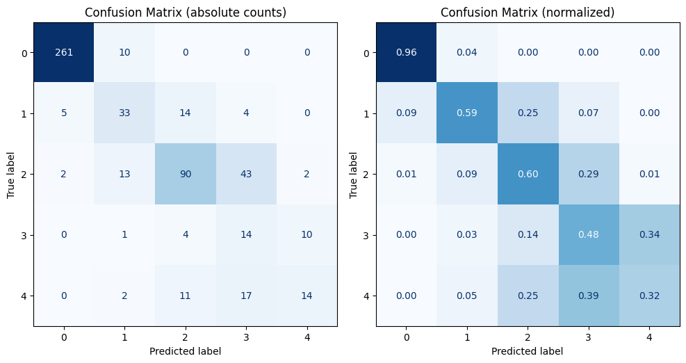

# Diabetic Retinopathy Classifier

An end-to-end computer vision pipeline and FastAPI service for grading diabetic retinopathy severity (0-4 scale) from retinal fundus images. 
It combines color-normalized preprocessing with an `EfficientNet-B0` classification–regression ensemble and Grad-CAM visual explanations. 
On a 15% held-out test split of APTOS-2019, the ensemble reaches **0.884 Quadratic Weighted Kappa (QWK)**, an agreement metric where 0 reflects random chance and 1.0 indicates complete agreement with human graders.

## Results

| Model                                                   | Test QWK | Gain |
|:--------------------------------------------------------| :---: | :---: |
| `EfficientNet-B0` (Cross-Entropy with smoothed weights) | 0.847 | — |
| **`EfficientNet-B0` (CE + Regression Ensemble)**        | **0.884** | **+0.037** |

The ensemble improves test QWK by **+0.037** over the standalone classifier, with a paired bootstrap 95% confidence interval of **[0.018, 0.059]**. Because the interval stays above zero, the gain is unlikely to come from test-set randomness alone.
The gain comes mainly from fewer large errors: 22 test images are off by two or more grades, versus 41 for the standalone classifier.

**Test confusion matrices - Ensemble**



## Approach

- **Color Normalization & Preprocessing:** An HSV saturation check showed that "cool" fundus images concentrated in class 0, creating a shortcut-learning risk. Ben Graham color normalization was applied to standardize appearance across images. 
- **Classification–Regression Ensemble:** While top candidate backbones performed similarly (~0.85 validation QWK), `EfficientNet-B0` ran 2-6x faster. Blending classifier and regressor predictions via a weighted average improves QWK over classification alone.
- **Evaluation:** A stratified train/val/test split was used, ensemble weight and thresholds were tuned on validation, and the test set was run once for a final comparison between the standalone classifier and the ensemble under a pre-defined acceptance rule (accepting the ensemble if its QWK is no more than 0.01 below the classifier).
- **FastAPI & Grad-CAM Serving:** A FastAPI service exposes endpoints for predictions and Grad-CAM explanations. Inference runs via `asyncio.to_thread` to avoid blocking the event loop, while an `asyncio.Lock` around shared Grad-CAM models prevents concurrent request interference.

## Limitations

- **Clinical use:** The model is a research and demonstration prototype and cannot be used for clinical diagnosis or medical decision-making.
- **Weak on severe stages:** Recall is below 0.50 for severe grades (class 3: 0.48, class 4: 0.32; only 29 and 44 test images). Class 4 is mostly under-graded (30 of 44 images), likely because the ensemble pulls predictions toward the middle of the scale.
- **Single-dataset generalization:** Training and evaluation used APTOS-2019 alone, leaving performance on other cameras, clinics, or populations unverified.
- **Validation tuning and single-run variance:** Tuning thresholds and blend-weight on validation risks overfitting to it, and models were trained on a single split without multi-seed or cross-validation runs.
- **Color-bias check:** Preprocessing addressed color differences across images, but whether color bias still affects predictions was not explicitly tested.

## Next steps

1. **Quantify result stability:** Repeat training with several seeds (or cross-validation) to put error bars on the results, especially for the severe classes, which have only a few dozen test images.
2. **Refine the training recipe:** Add a learning-rate schedule and train longer; validation curves with a fixed learning rate were noisy.
3. **Test generalization:** Evaluate on an external fundus dataset to check performance beyond APTOS-2019.
4. **Check for residual color bias:** Report test metrics separately for "cool" and "warm" images.

## How to run

**Prerequisites:** Docker (with Compose v2 for option 2).

The model weights are hosted separately from the source code on Hugging Face.

### Option 1: Quickstart (bundled weights)

Run the self-contained image (`:with-weights`) without cloning the repository or downloading weights manually:

1. Start the container:
   ```bash
   docker run -d -p 8000:8000 --name dr-clf-api valerialtv/dr-clf-api:with-weights
   ```

2. Verify that the API is ready:
   ```bash
   curl http://localhost:8000/health
   ```
   Interactive Swagger documentation is available at http://localhost:8000/docs.


3. Stop and remove the container:
   ```bash
   docker rm -f dr-clf-api
   ```
   
### Option 2: Docker Compose (external weights)

Use this option if you want to decouple model weights from the image or 
swap in your own checkpoints via a volume mount (./models:/app/models).

1. Clone the repository and enter the project directory:
   ```bash
   git clone https://github.com/valeria-ltv/diabetic-retinopathy-classifier.git
   cd diabetic-retinopathy-classifier
   ```

2. Download `effnetb0_clf.pth` and `effnetb0_reg.pth` from the [Hugging Face repository](https://huggingface.co/valeria2648/diabetic-retinopathy-effnetb0-aptos2019) into the local `./models/` directory:
   ```text
   models/
   ├── effnetb0_clf.pth
   └── effnetb0_reg.pth
   ```

3. Start the service using Docker Compose (mounts ./models into /app/models inside the container):
   ```bash
   docker compose up -d
   ```

4. Verify that the API is ready:
   ```bash
   curl http://localhost:8000/health
   ```
   Interactive Swagger documentation is available at http://localhost:8000/docs.


5. Stop and remove the container:
   ```bash
   docker compose down
   ```